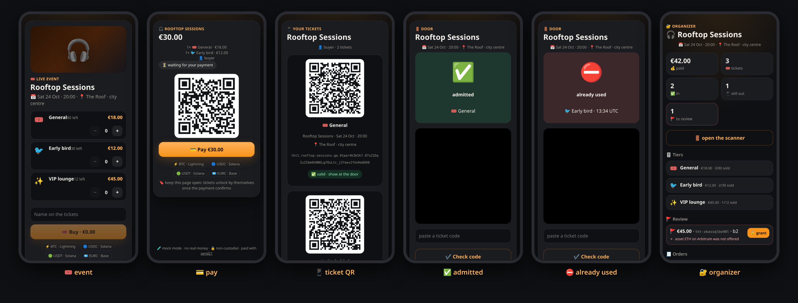
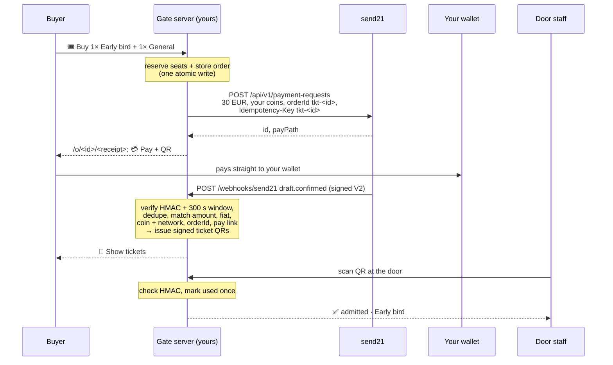

# send21 event ticket 🎟️

**Sell tickets for a night out: pick a tier, pay with crypto, get a signed QR. The door admits each ticket once.** Built on [send21](https://send21.io), crypto pay links and API for people and AI agents.

<p></p>

<sub>Mock-mode screenshots, not real payments.</sub>

- 🎟️ An event page with tiers and live capacity; one send21 pay link per order, priced in fiat
- 📱 After payment, a ticket page with a signed QR (no personal data in the code)
- 🚪 A door scanner that admits each ticket exactly once; a second scan shows ⛔ already used

## Quickstart

1. **Try it now, no keys:** `npm install && npm run dev`, open http://localhost:3000. Pick tickets, pay on the mock page, open 📱 Show tickets. Door: http://localhost:3000/scan/demo. Organizer: http://localhost:3000/organizer/demo.
2. **send21 key.** On [send21.io/api-keys](https://send21.io/api-keys), create a key with `drafts:write` (add `webhooks:manage` for step 4).
3. **Configure.** `cp .env.example .env`: the key, `PUBLIC_URL`, your receiving addresses, and three secrets: `TICKET_SECRET`, `STAFF_TOKEN`, `ORGANIZER_TOKEN` (`openssl rand -hex 32`).
   - 🔐 **Approve your receiving addresses in send21.** New send21 accounts (created on or after 20 Oct 2026) only accept receiving addresses the owner approved, including Lightning addresses. Add them in the send21 app, or propose one from an agent (MCP `propose_receiving_address`), then sign in and approve it with a passkey or authenticator code. No API key can approve an address. Older accounts can opt in under Settings.
4. **Webhook.** Put the server behind your own HTTPS address (for example a reverse proxy with a free Let's Encrypt certificate and `TRUST_PROXY=1`), then `npm run webhook:register` and paste the printed `SEND21_WEBHOOK_SECRET` into `.env`.
5. **Your night and go.** `cp event.example.json event.json`, edit the name, when, venue and tiers, then `npm run build && npm start`. Share `https://your-site/`.

## How it works

🎟️ **Buy** reserves the seats and stores the order in one write, then creates **one** send21 payment request: priced in fiat, your coins, `orderId` `tkt-<id>` that is also the `Idempotency-Key`. The buyer lands on `/o/<id>/<receipt>` (only the receipt key's hash is stored), with a 💳 Pay button and a QR. They pay on send21 in a new tab; the order page unlocks by itself.



| Webhook | Order | Tickets? |
| --- | --- | --- |
| `draft.seen` | 👀 seen | no (seats held) |
| `draft.confirmed`, matches the order | ✅ paid | **yes, one QR per seat** |
| `draft.confirmed`, does **not** match | 🚩 flagged for the organizer | no, until 🔓 grant |
| `draft.amount_mismatch` → accepted / rejected / unresolved | ⚠️ → 👍 / ↩️ / 🚩 | only after a matching `draft.confirmed` (or a grant for unresolved) |
| `payment_request.expired`, `draft.expired` | ⌛ expired (seats back; a late exact payment still issues tickets) | no |

**Ticket QR.** `tkt1.<event>.<tier>.<ticket id>.<HMAC>`: signed with `TICKET_SECRET` over the event, the tier and the ticket id. No name, no receipt, no order id. A replaced secret voids every code.

**🚪 Door.** `/scan` needs `STAFF_TOKEN` (and a gate name). Camera QR when the browser supports it; paste-code always works as a fallback (shown by default in mock mode). The "used" mark is written in the same step as the check, so two phones cannot both admit one ticket. A second scan shows ⛔ already used with the time. Forged, wrong-event, void and unknown codes are rejected.

**🔐 Organizer.** `/organizer` needs `ORGANIZER_TOKEN` (different from the door token). Sales per tier, live check-ins, the 🚩 review list. Amount mismatches are accepted or declined on send21; flagged or unresolved orders can be unlocked with 🔓 grant, which issues their tickets.

**⚡ Lightning.** send21 fetches an invoice from your Lightning address and confirms the payment when your wallet provider supports **LUD-21**. Without it the money still reaches you, but tickets do not unlock on their own. See [Lightning](https://send21.io/docs/lightning).

**Fees.** One small send21 fee per paid order (0.49% on small payments, at least $0.01), never taken from the payment. See [pricing](https://send21.io/pricing).

## Troubleshooting

- **422 `address_not_approved`:** a receiving address isn't approved in your send21 account, so nothing was created. Sign in to send21, approve the address (passkey or authenticator code), then try again.

## Security notes

- **Signature V2 only.** Every delivery is checked with `X-Send21-Signature-V2`: HMAC-SHA256 over `<t>.<delivery id>.<raw body>`, constant-time compare, refused when more than **300 s** old or in the future. A bad signature gets `401` and nothing is stored.
- **The receiver dedupes deliveries.** send21 does not dedupe deliveries. Retries reuse the same `X-Send21-Delivery` id, and the receiver ignores deliveries it already handled: a delivery id, or the same body under a new id (sha256 of the raw body), is applied once. Separately, the `Idempotency-Key` makes one order one link. The delivery id and the order change (and ticket issuance) are written together before the `2xx`, so a restart cannot apply it twice; a failed write answers `500` so send21 retries. Your server also checks amount and asset against the order before issuing tickets.
- **Exact match or no tickets.** A `draft.confirmed` must match the stored order: `orderId`, pay link id, `status: Confirmed`, a txId, the fiat currency, the exact total (in cents) and a coin **and** network that order offered. Anything else is 🚩 for the organizer, never issued automatically. Paid is final.
- **Seats are reserved atomically.** Available = capacity − seats held by open/seen/review/accepted/paid/unresolved/flagged orders, computed inside the same write that reserves them.
- **No guessable tickets.** Order pages need a 256-bit receipt key (stored only as a hash). Ticket QRs are HMAC-signed and single-use at the door. Staff and organizer sessions are HMAC-signed cookies (`HttpOnly`, `SameSite=Strict`, path-scoped; `Secure` on https), with Origin and Fetch checks on POSTs.
- **Hardened pages.** Strict CSP (`'self'`, no inline script or style; `media-src` for the camera), `frame-ancestors 'none'`, tiny body limits, buys and scans rate-limited per IP. The API key is never logged and cannot move funds.
- **Data.** One JSON file (`DATA_FILE`, mode 600), written atomically. For several processes, use SQLite or Postgres.

## Develop

```bash
npm run check   # typecheck + lint + tests: signature, dedupe, seat races, matching, QR codes, single admit, organizer grant
```

API reference: [send21.io/docs](https://send21.io/docs) · [quickstart](https://send21.io/docs/quickstart) · [webhooks](https://send21.io/docs/webhooks) · [llms-full.txt](https://send21.io/llms-full.txt). More examples: [send21-examples](https://github.com/send21io/send21-examples).

Questions: [info@send21.io](mailto:info@send21.io). License: [MIT](LICENSE).
